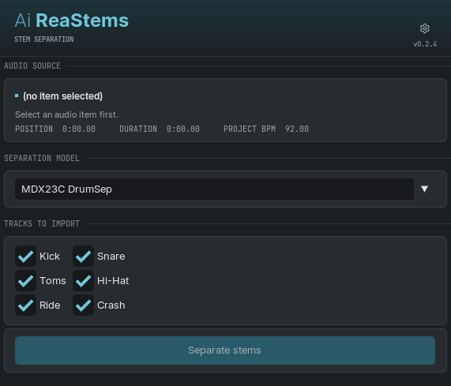
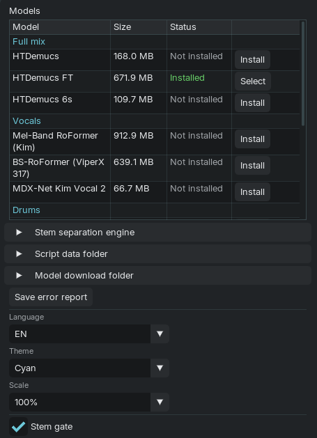

# Ai ReaStems

Ai ReaStems splits audio into stems right inside REAPER. Select audio on a
track, pick a model and choose which stems to add to the project. Processing
runs locally through stems.cpp. Every selected stem appears on its own track
below the source item.

Russian version: [README.ru.md](README.ru.md)

## Features

- Split a mix into vocals, bass, drums and other parts with HTDemucs.
- Split drum audio into kick, snare, toms, hi-hat, ride and crash with
  MDX23C DrumSep.
- Extract vocals and clean recordings from noise, echo and reverb with
  dedicated models.
- Process one or several items on a track, respecting stretch markers and the
  playback rate of active takes. Gaps are filled with silence and overlaps are
  summed.

## Interface

**Main window** · model selection and stems to insert into the project.



**Settings** · model catalog, engine updates and storage folders.



The screenshots show the 0.2.4 interface; the current installer is 0.2.5.

## Models

Models are downloaded one by one from the Settings dialog: size and SHA-256
are verified before a model is used, and no weights are bundled in the
archive. Sizes are for the F32 variant.

**Full mix**

| Model | Splits into | Size |
| --- | --- | --- |
| HTDemucs | drums, bass, vocals, other | 160 MB |
| HTDemucs FT | the same, fine-tuned | 641 MB |
| HTDemucs 6s | the same four parts plus guitar and piano | 105 MB |

**Vocals**

| Model | Splits into | Size |
| --- | --- | --- |
| Mel-Band RoFormer (Kim) | vocals, instrumental | 871 MB |
| BS-RoFormer (ViperX 317) | vocals, instrumental | 609 MB |
| MDX-Net Kim Vocal 2 | vocals, instrumental — the lightest in this group | 64 MB |

**Drums**

| Model | Splits into | Size |
| --- | --- | --- |
| MDX23C DrumSep | kick, snare, toms, hi-hat, ride, crash | 417 MB |

**Audio cleanup**

| Model | Splits into | Size |
| --- | --- | --- |
| UVR DeNoise Lite | noise, clean signal | 17 MB |
| UVR DeNoise | noise, clean signal | 121 MB |
| UVR DeEcho Normal | echo, echo-free signal | 121 MB |
| UVR DeEcho Aggressive | echo, echo-free signal (stronger suppression) | 121 MB |
| UVR DeEcho DeReverb | reverb, dry signal | 213 MB |
| BS-RoFormer Room DeReverb | room reverb, dry signal | 112 MB |

13 models in total. To try the script, **HTDemucs** is enough — 160 MB, splits
a mix into four parts.

## Installation via ReaPack

1. Install [ReaPack](https://reapack.com) if you don't have it.
2. In REAPER open *Extensions → ReaPack → Import repositories…*
3. Paste the Aiwist scripts index URL. It is the single address for every
   Aiwist script; new ones appear there automatically:

   ```
   https://github.com/Aiwist/ai-scripts/raw/main/index.xml
   ```

4. Press *OK*, then *Extensions → ReaPack → Browse packages*, find
   **Ai ReaStems** and install the package.
5. If **ReaImGui** is not installed yet, get it from the *ReaTeam Extensions*
   repository.
6. Open **Actions → Show action list**, find `Aiwist_ReaStems.lua` and press
   **Run**.

ReaPack installs the script, the stems.cpp engine, fonts and licenses. Models
are downloaded separately from the Ai ReaStems settings.

## Installation on Windows

Download `Ai_ReaStems_Setup_0.2.5_Windows.zip` from the **Releases** section.
Unpack the archive completely, run `Установить.bat` and choose the REAPER
resource folder. The installer verifies the package, installs Ai ReaStems with
the stems.cpp Vulkan/CPU engine, hooks up ReaImGui if needed and adds the
script to the Actions list. Windows x64 and REAPER x64 are supported.

In REAPER open **Actions → Show action list**, find `Aiwist_ReaStems.lua` and
press **Run**. Models are loaded separately from the script settings.

For manual installation, copy the contents of `ReaStems/` into
`Scripts/Aiwist/ReaStems` inside the REAPER resource folder and add
`Aiwist_ReaStems.lua` through **New action → Load ReaScript**.

Ai ReaStems is the new name of Ai Stems. On update the script reads the
previous settings and recognises models downloaded earlier.

## Folders and models

| Stored data | Default folder |
| --- | --- |
| Script and bundled engine | `<REAPER resources>/Scripts/Aiwist/ReaStems/runtime/stems-v0.1.6` for the engine |
| stems.cpp updates | `<REAPER resources>/Scripts/Aiwist/ReaStems/runtime/stems-updates` |
| Data, temporary WAV files and cache | `%LOCALAPPDATA%/Aiwist/Ai ReaStems` |
| New GGUF models | `%LOCALAPPDATA%/Ai ReaStems/models` |

With a portable REAPER, data is stored in `<REAPER resources>/Data/Ai ReaStems`
by default and models in its `models` subfolder. Select or copy the current
path, open the folder in Explorer, or paste a new path and press **Apply**.
Reopen the script after changing the data folder. Models found in the previous
folder remain available as long as it is reachable by REAPER. Cache and logs
belong to the selected data folder.

The settings table lists all 13 models from the stems.cpp 0.1.6 catalog in the
F32 variant. Models are downloaded from Hugging Face one by one. Size and
SHA-256 are verified before a model is used. Matching GGUF files from
Ai Transcriber Plus are not downloaded again. The engine update is started
manually from the settings and fetches a verified Vulkan/CPU build from
GitHub Releases.

[stems.cpp model catalog and licenses](https://github.com/betweentwomidnights/stems.cpp/blob/v0.1.6/docs/DISTRIBUTION.md)

## Diagnostics

Errors are written to `logs/errors.log` in the Ai ReaStems data folder. The
**Save error report** button in the settings, or under an error message,
creates a ZIP in the `reports` subfolder. The report contains the version,
the error and available job logs. Audio, models and job configurations are
excluded.

## License

Ai ReaStems code is distributed under the Apache License 2.0. The engine,
fonts and models have their own terms. [Project license](LICENSE) ·
[Notices](NOTICE.txt) · [Component licenses](ReaStems/INSTALL_LICENSES_RU.txt)
