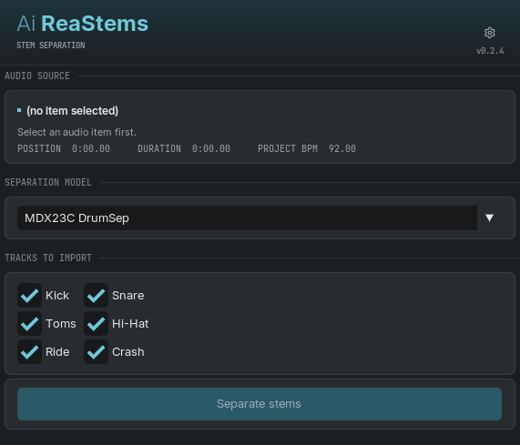
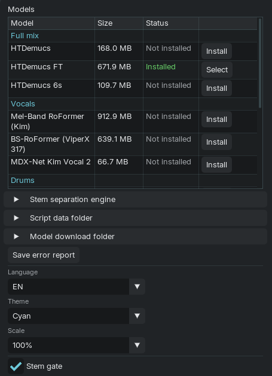

# Ai ReaStems

Ai ReaStems разделяет аудио на стемы прямо в REAPER. Выделите аудио на
дорожке, выберите модель и отметьте, какие стемы нужно добавить в проект.
Обработка выполняется локально через stems.cpp. Каждый выбранный стем
появляется на отдельной дорожке под исходной.

English version: [README.md](README.md)

## Возможности

- Разделение микса на вокал, бас, барабаны и другие партии с HTDemucs.
- Разделение барабанного аудио на бочку, рабочий, томы, хай-хэт, райд и крэш
  с MDX23C DrumSep.
- Извлечение вокала и очистка записей от шума, эха и реверберации
  с помощью специализированных моделей.
- Обработка одного или нескольких айтемов на одной дорожке с учётом
  стретч-маркеров и скорости активных тейков. Промежутки заполняются
  тишиной, а наложения суммируются.

## Интерфейс

**Главное окно** · выбор модели и стемов для вставки в проект.



**Настройки** · каталог моделей, обновление движка и выбор папок хранения.



На скриншотах показан интерфейс версии 0.2.4. Готовый установщик имеет версию 0.2.5.

## Установка через ReaPack

1. Установите [ReaPack](https://reapack.com), если его ещё нет.
2. В REAPER откройте *Extensions → ReaPack → Import repositories…*
3. Вставьте ссылку на общий индекс скриптов Aiwist — этот адрес один для всех
   его скриптов, новые появятся в нём автоматически:

   ```
   https://github.com/Aiwist/ai-scripts/raw/main/index.xml
   ```

4. Нажмите *OK*, затем *Extensions → ReaPack → Browse packages*, найдите
   **Ai ReaStems** и установите пакет.
5. Если ещё не установлен **ReaImGui**, поставьте его из репозитория
   *ReaTeam Extensions*.
6. Откройте **Actions → Show action list**, найдите `Aiwist_ReaStems.lua`
   и нажмите **Run**.

ReaPack ставит скрипт, движок stems.cpp, шрифты и лицензии. Модели
скачиваются отдельно из настроек Ai ReaStems.

## Установка на Windows

Скачайте `Ai_ReaStems_Setup_0.2.5_Windows.zip` в разделе **Releases**.
Распакуйте архив целиком, запустите `Установить.bat` и выберите папку
ресурсов REAPER. Установщик проверит комплект, установит Ai ReaStems
с движком stems.cpp Vulkan/CPU, при необходимости подключит ReaImGui
и добавит скрипт в Actions. Поддерживаются Windows x64 и REAPER x64.

В REAPER откройте **Actions → Show action list**, найдите `Aiwist_ReaStems.lua`
и нажмите **Run**. Модели загружаются отдельно из настроек скрипта.

При ручной установке поместите содержимое `ReaStems/` в
`Scripts/Aiwist/ReaStems` внутри папки ресурсов REAPER и добавьте
`Aiwist_ReaStems.lua` через **New action → Load ReaScript**.

Ai ReaStems — новое имя Ai Stems. При обновлении скрипт читает прежние
настройки и распознаёт ранее скачанные модели.

## Папки и модели

| Что хранится | Папка по умолчанию |
| --- | --- |
| Скрипт и комплектный движок | `<ресурсы REAPER>/Scripts/Aiwist/ReaStems/runtime/stems-v0.1.6` для движка |
| Обновления stems.cpp | `<ресурсы REAPER>/Scripts/Aiwist/ReaStems/runtime/stems-updates` |
| Данные, временные WAV и кэш | `%LOCALAPPDATA%/Aiwist/Ai ReaStems` |
| Новые модели GGUF | `%LOCALAPPDATA%/Ai ReaStems/models` |

Для портативного REAPER данные по умолчанию хранятся в
`<ресурсы REAPER>/Data/Ai ReaStems`, а модели — в её подпапке `models`.
Выделите или скопируйте текущий путь, откройте папку в Проводнике
либо вставьте новый путь и нажмите **Применить**. После смены папки данных откройте
скрипт заново. Найденные модели из прежней папки доступны, пока она доступна
REAPER. Кэш и журналы относятся к выбранной папке данных.

Таблица настроек содержит все 13 моделей из каталога stems.cpp 0.1.6
в варианте F32. Модели скачиваются с Hugging Face по одной. Размер
и SHA‑256 проверяются перед подключением. Подходящие GGUF из Ai Transcriber
Plus повторно не скачиваются. Обновление движка запускается вручную из
настроек и подгружает проверенную сборку Vulkan/CPU из GitHub Releases.

[Каталог и лицензии моделей stems.cpp](https://github.com/betweentwomidnights/stems.cpp/blob/v0.1.6/docs/DISTRIBUTION.md)

## Диагностика

Ошибки записываются в `logs/errors.log` в папке данных Ai ReaStems. Кнопка
**Сохранить отчёт об ошибке** в настройках или под сообщением об ошибке
создаёт ZIP в подпапке `reports`. Отчёт содержит сведения о версии, ошибке
и доступные журналы задания. Аудио, модели и конфигурации заданий исключены.

## Лицензия

Код Ai ReaStems распространяется по Apache License 2.0. У движка,
шрифтов и моделей собственные условия. [Лицензия проекта](LICENSE) ·
[Уведомления](NOTICE.txt) · [Лицензии компонентов](ReaStems/INSTALL_LICENSES_RU.txt)
